# 이모부

**이사 견적 서비스 · 앱 · 웹 디자인** — 이사의 모든 것을 부탁해

> 고객은 집 크기와 짐 사진으로 무료 견적을 신청하고, 관리자는 신청을 제휴 이사업체 한 곳에 배정해요. 업체가 수락하면 상담 · 예약 확정 · 이사 완료까지 한 흐름으로 이어집니다.

### [▶ 프로토타입 보기](https://lhw031128.github.io/imobu-design/) · [Figma 디자인 파일](https://www.figma.com/design/XidN1v0Vr8o1ybhXEy1NUg)

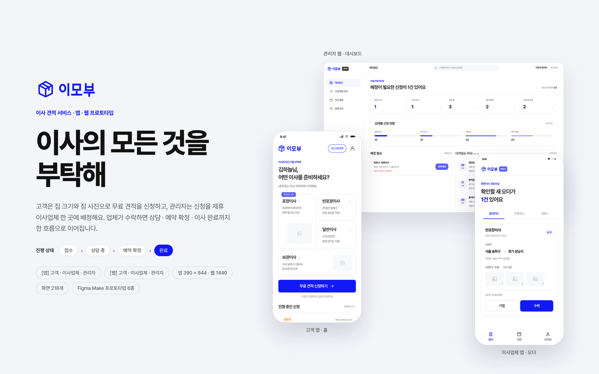

## 프로젝트 개요

| 항목 | 내용 |
| --- | --- |
| 형태 | 모바일 앱 390 × 844 · 웹 1440 — 고객 · 이사업체 · 관리자 |
| 주요 흐름 | 견적 신청 → 업체 배정 → 수락 · 상담 → 예약 확정 → 이사 완료 |
| 작업 도구 | Figma Make, Claude 디자인, Figma (디자인 · 프로토타입) |
| 화면 수 | 218개 (고객 앱 53개, 이사업체 앱 29개, 관리자 앱 35개, 고객 웹 33개, 이사업체 웹 30개, 관리자 웹 38개) |
| 디자인 | [@LHW031128](https://github.com/LHW031128) |

## 화면 구성

<details><summary><b>고객 앱</b> — 53개 화면</summary>

- 01 — 진입 · 로그인 (12)
- 02 — 홈 · 내 정보 (6)
- 03 — 견적 신청 · 이사 종류 (3)
- 04 — 견적 신청 · 주소·날짜 (15)
- 05 — 견적 신청 · 집 크기·사진 (4)
- 06 — 견적 신청 · 연락처·접수 (7)
- 07 — 신청내역 · 상세 (6)

</details>

<details><summary><b>이사업체 앱</b> — 29개 화면</summary>

- 01 — 로그인 (3)
- 02 — 오더 목록 (3)
- 03 — 새 오더 · 수락·거절 (9)
- 04 — 예약 확정 · 이사 완료 (8)
- 05 — 일정 · 내 정보 (6)

</details>

<details><summary><b>관리자 앱</b> — 35개 화면</summary>

- 01 — 로그인 (3)
- 02 — 대시보드 (1)
- 03 — 신청·배정 목록 (8)
- 04 — 신청 상세 (10)
- 05 — 업체 배정 · 상태 변경 (6)
- 06 — 일정 · 업체 관리 (7)

</details>

<details><summary><b>고객 웹</b> — 33개 화면</summary>

- 01 — 홈 · 전체 메뉴 (8)
- 02 — 로그인 (9)
- 03 — 견적 신청 (10)
- 04 — 신청내역 · 상세 (6)

</details>

<details><summary><b>이사업체 웹</b> — 30개 화면</summary>

- 01 — 로그인 (3)
- 02 — 오더 목록 (3)
- 03 — 새 오더 · 수락·거절 (9)
- 04 — 예약 확정 · 이사 완료 (8)
- 05 — 일정 · 내 정보 (7)

</details>

<details><summary><b>관리자 웹</b> — 38개 화면</summary>

- 01 — 로그인 (3)
- 02 — 대시보드 (2)
- 03 — 신청·배정 관리 (8)
- 04 — 신청 상세 (10)
- 05 — 업체 배정 · 상태 변경 (6)
- 06 — 이사 일정 (6)
- 07 — 업체 관리 (3)

</details>

## 주요 화면

**고객 웹 · 홈**

[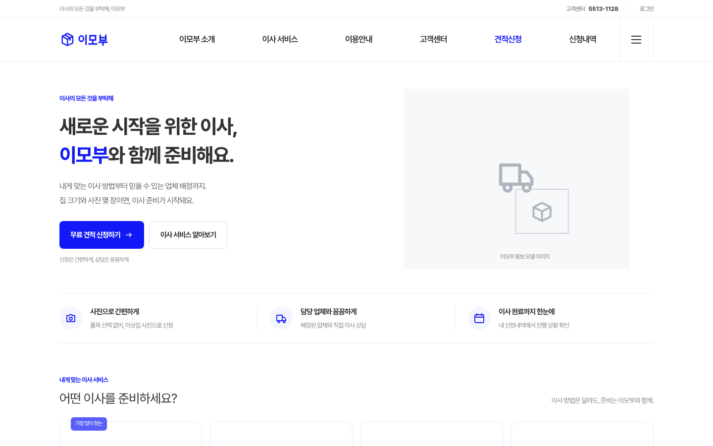](https://lhw031128.github.io/imobu-design/view.html?s=CW-HomeGuest)

**이사업체 웹 · 오더**

[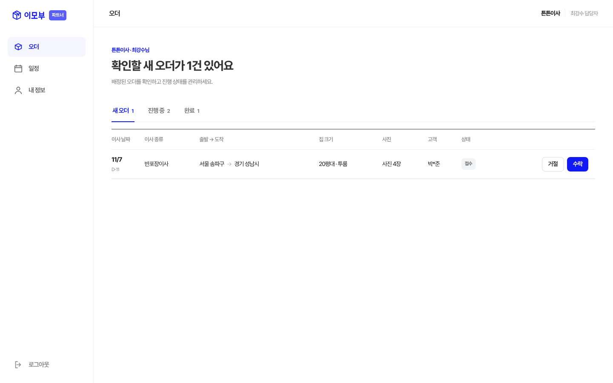](https://lhw031128.github.io/imobu-design/view.html?s=PW-Orders)

**관리자 웹 · 대시보드**

[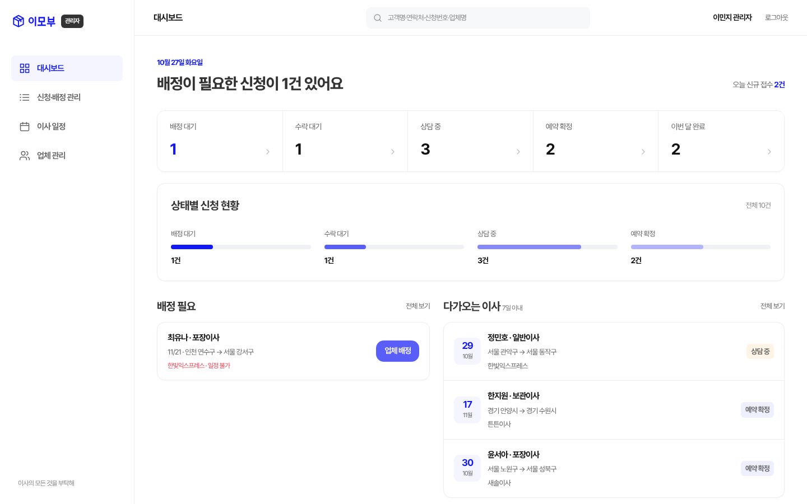](https://lhw031128.github.io/imobu-design/view.html?s=AW-Dashboard)

**관리자 웹 · 업체 배정 팝업**

[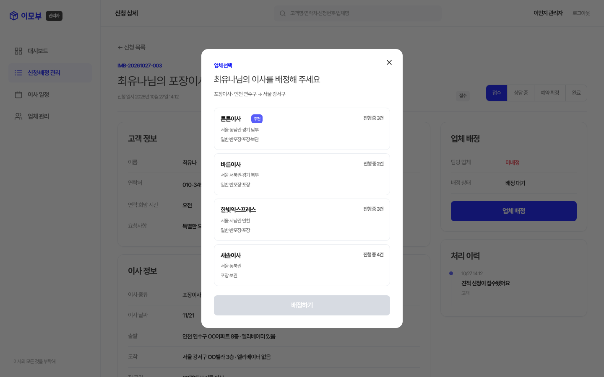](https://lhw031128.github.io/imobu-design/view.html?s=AW-AssignModal)

<table>
<tr><td align="center" valign="top"><a href="https://lhw031128.github.io/imobu-design/view.html?s=CA-Home">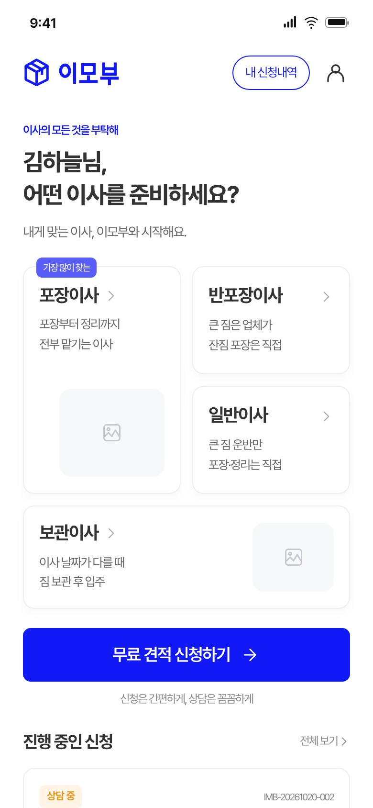</a><br><sub>고객 앱 · 홈</sub></td><td align="center" valign="top"><a href="https://lhw031128.github.io/imobu-design/view.html?s=CA-Form1">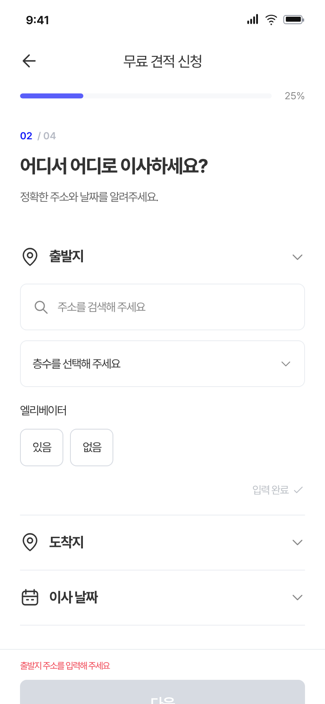</a><br><sub>고객 앱 · 견적 신청</sub></td><td align="center" valign="top"><a href="https://lhw031128.github.io/imobu-design/view.html?s=CA-Detail">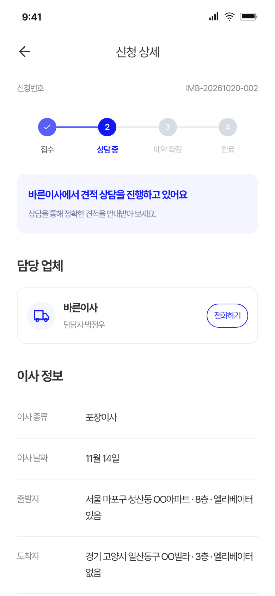</a><br><sub>고객 앱 · 신청 상세</sub></td></tr>
<tr><td align="center" valign="top"><a href="https://lhw031128.github.io/imobu-design/view.html?s=PA-Orders">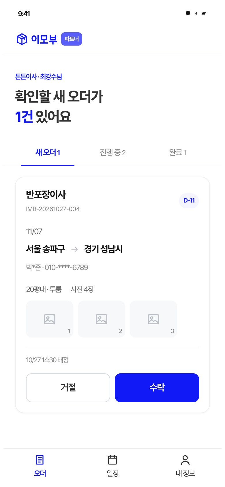</a><br><sub>이사업체 앱 · 오더</sub></td><td align="center" valign="top"><a href="https://lhw031128.github.io/imobu-design/view.html?s=PA-DetailAccepted">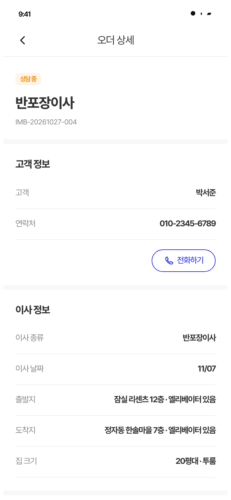</a><br><sub>이사업체 앱 · 오더 상세</sub></td><td align="center" valign="top"><a href="https://lhw031128.github.io/imobu-design/view.html?s=PA-Calendar">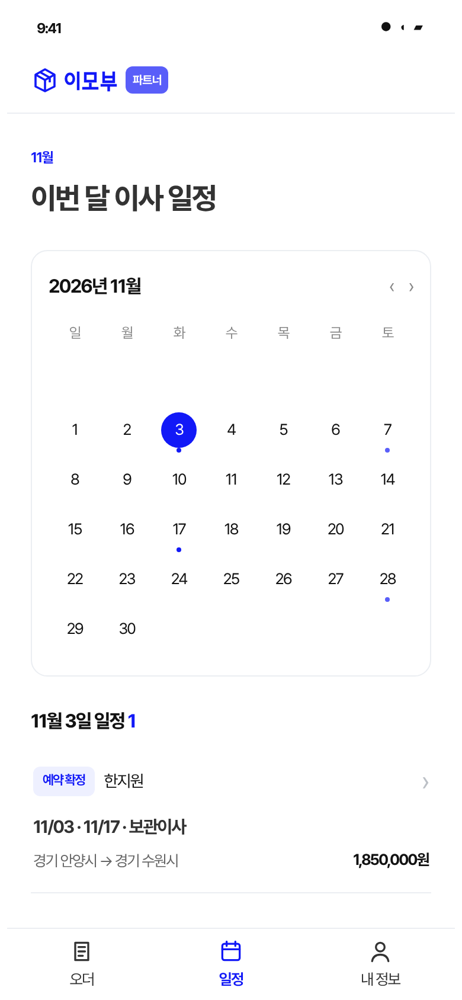</a><br><sub>이사업체 앱 · 일정</sub></td></tr>
<tr><td align="center" valign="top"><a href="https://lhw031128.github.io/imobu-design/view.html?s=AA-Dashboard">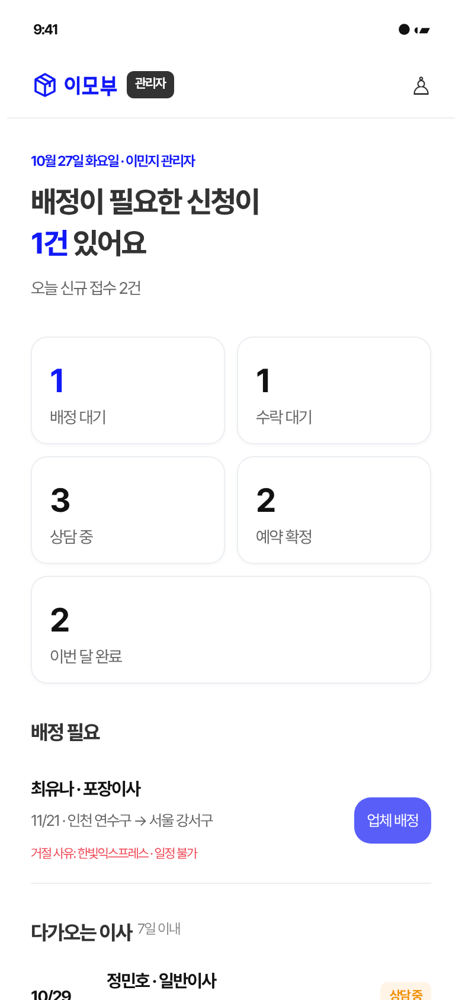</a><br><sub>관리자 앱 · 대시보드</sub></td><td align="center" valign="top"><a href="https://lhw031128.github.io/imobu-design/view.html?s=AA-List">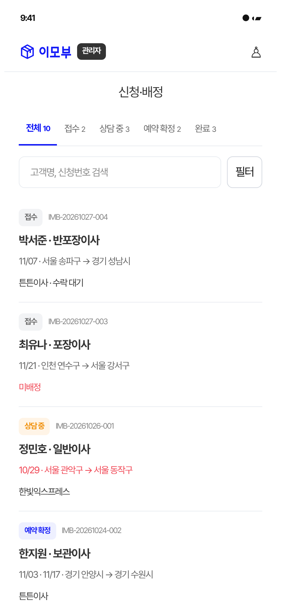</a><br><sub>관리자 앱 · 신청·배정</sub></td><td align="center" valign="top"><a href="https://lhw031128.github.io/imobu-design/view.html?s=AA-SheetAssign">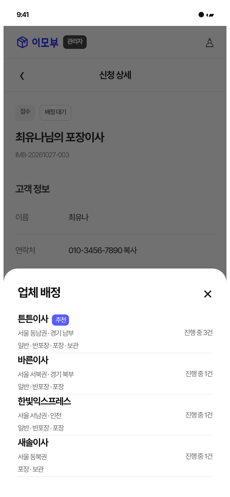</a><br><sub>관리자 앱 · 업체 배정</sub></td></tr>
</table>

## Figma 파일

[Figma 디자인 파일](https://www.figma.com/design/XidN1v0Vr8o1ybhXEy1NUg)에 같은 218개 화면이 편집 가능한 레이어로 들어 있어요.

| 페이지 | 내용 |
| --- | --- |
| 00. 커버 | 프로젝트 커버 |
| 01. [앱] 고객 | 53개 화면 · 섹션 7개 |
| 02. [앱] 이사업체 | 29개 화면 · 섹션 5개 |
| 03. [앱] 관리자 | 35개 화면 · 섹션 6개 |
| 04. [웹] 고객 | 33개 화면 · 섹션 4개 |
| 05. [웹] 이사업체 | 30개 화면 · 섹션 5개 |
| 06. [웹] 관리자 | 38개 화면 · 섹션 7개 |
| 07. 토큰 · 공통 컴포넌트 | 아이콘 컴포넌트 138개 |

- 섹션 이름은 위 화면 구성과 같아요 (예: 01 — 진입 · 로그인).
- 프로토타입: 화면 사이 클릭 연결 1,843개. 섹션마다 시작점이 있어서 Figma의 ▶ 재생으로 바로 볼 수 있어요.
- 글꼴: 기본은 Noto Sans KR이에요. Pretendard가 설치된 환경에서는 변수 `타이포그래피` 컬렉션의 `font/family`를 `Pretendard`로, `font/semibold`를 `SemiBold`로 바꾸면 전체 텍스트가 한 번에 바뀌어요.

## 둘러보는 방법

- **[프로토타입 사이트](https://lhw031128.github.io/imobu-design/)** 에서 그룹별 전체 화면을 볼 수 있어요. 화면을 누르면 실제 크기로 열리고, 화면 안의 버튼 · 메뉴 · 탭을 누르면 연결된 화면으로 이동해요.
- 뷰어에서 키보드 ← → 로 화면을 순서대로 넘겨 볼 수 있어요.

## 폴더 구조

```
index.html        화면 갤러리 (GitHub Pages 첫 화면)
view.html         화면 뷰어 (프로토타입 링크로 화면 이동)
screens/          화면별 HTML
assets/           폰트 · 이미지 · 썸네일
docs/             README 이미지
```

## 참고

- 화면에 나오는 업체명 · 이름 · 연락처 · 금액은 모두 예시 데이터예요.
- 폰트: [Pretendard](https://github.com/orioncactus/pretendard) (SIL Open Font License 1.1) — `assets/fonts/Pretendard-LICENSE.txt`
